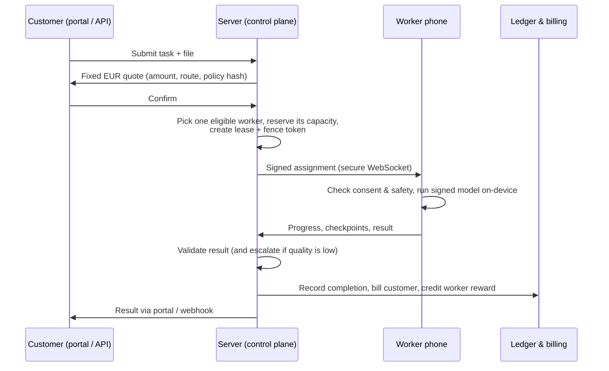

# What This Project Does

> Plain-language overview for teammates, designers and new contributors.
> Engineering authority remains [EDGE-MINT-TARGET-ARCHITECTURE-v2.md](EDGE-MINT-TARGET-ARCHITECTURE-v2.md) and [production/canonical-decisions.yaml](../production/canonical-decisions.yaml). If this page disagrees with them, they win.

**Names:** *EdgeMint* is the internal/codebase name (packages, services, docs). *FibonAI* is the public brand used on the marketing site and in launch material.

---

## In one sentence

A business sends an AI job (for example "read the text in this invoice"), sees a fixed price in euros before anything runs, and the platform runs that job on a verified network of opted-in Android phones — falling back to cloud servers only when the customer's policy allows it, with every step recorded.

---

## Who it serves

| Who | What they get |
| --- | --- |
| **Customers** (businesses, developers) | An API and a web portal to submit AI tasks — OCR, document extraction, classification, summarization, image checks. A fixed EUR quote before each task, structured results, webhooks and a full audit trail. |
| **Workers** (phone owners) | An app that runs assigned AI tasks on their phone **only while they opt in**, within battery/Wi-Fi/thermal limits they control. They earn variable EUR rewards. Not crypto mining, no guaranteed income. |
| **Operators** (the FibonAI team) | An operations console for routing, fraud review, reconciliation, worker management, billing and incident handling. |

---

## How one task flows

1. **Submit.** The customer uploads a file through the portal or API and picks a task type from the catalog.
2. **Quote.** The server prices the task from the published PriceBook (e.g. Document OCR from €0.0025 per page) plus plan, priority and verification modifiers. The quote is immutable once issued.
3. **Schedule.** Only the server decides which phone runs the task. It checks eligibility (consent, model installed, runtime compatible, enough RAM/storage, not overheating), scores candidates, and reserves capacity in one atomic database transaction.
4. **Run.** The phone validates the signed assignment and starts automatically — there is no per-task "Accept/Reject" button. It runs a signed, hash-verified model locally. Long inputs are split into chunks with checkpoints so work can resume.
5. **Verify.** The server validates every result. Phones and their outputs are treated as untrusted.
6. **Settle.** Exactly one accepted completion per task: the customer is billed once, the worker is credited once, and everything is written to a hash-chained audit log.
7. **Fallback.** If no phone can run it and the customer's policy permits, the task runs in the cloud — and the reason and extra cost are recorded. There is no silent fallback.

---

## What it can run today (on the phone)

The worker app currently executes these pipelines (see [`task_type_mapper.dart`](../src/apps/worker/lib/tasks/task_type_mapper.dart)):

| Pipeline | What it does | Engine |
| --- | --- | --- |
| `ocr.extract_text.v1` | Read text from document images | PaddleOCR (English detector + recognizer, ONNX) |
| `document.extract / classify / summarize` | Structured fields, document type, summaries | OCR → on-device LLM |
| `text.summarize / classify / direct` | Summaries, labels, direct prompts on text | On-device LLM |
| `vision.analyze.v1` | Image classification, safety/moderation, catalog tagging | Vision pipeline |
| `quality.document_image`, `quality.blurry_image`, `catalog.duplicate_image` | Image quality and duplicate checks | Local image analysis |
| `image.remove_background.v1` | Background removal | Local image model |

- **On-device LLM baseline:** Qwen2.5 0.5B Instruct (~547 MB) via `flutter_gemma` / MediaPipe on CPU, with a ~1280-token working context. Longer inputs are chunked before they reach the model.
- **Catalog:** the backend catalog lists **56 task types**. Many map onto the pipelines above; not every catalog entry has its own dedicated handler.
- **One heavy model per phone** by default (plus OCR and tiny specialists), to keep storage low. The scheduler prefers sending tasks to phones that already have the right model.

---

## Money and rewards

- **Currency:** EUR only, stored as integer micro-euros (never floating point).
- **Customers:** prepaid credits / Stripe Billing, quotes before every task, invoices and refunds.
- **Workers:** rewards are EUR-denominated liabilities paid via Stripe Connect after identity checks. In unsupported countries, earning is disabled.
- **Tokens:** **disabled for GA1.** No token sale, no on-chain per-task settlement, no token value or investment claims.

---

## Rules the system never breaks

- **The server is the only scheduler.** Phones never pick, retry, reassign or reroute tasks on their own.
- **Consent first.** A phone runs work only while its owner has opted in and the device is within safe limits. It pauses or stops when consent expires, memory runs low or it gets too hot.
- **Lease + fence tokens.** Every assignment has a lease and an increasing fence number, so a stale or duplicated worker can never overwrite a newer result.
- **Exactly-once completion and reward.** Duplicates are detected, not double-paid.
- **Tenant isolation.** Every customer table is workspace-scoped with PostgreSQL row-level security; customer identity is never shown to workers; temporary inputs are deleted within 15 minutes.
- **Everything is auditable.** Assignments, fallbacks, billing and reward events land in an append-only, hash-chained ledger.

---

## What is in this repository

| Path | Contents |
| --- | --- |
| `src/backend/` | Python 3.13 / FastAPI services: API gateway, task intake, pricing, router, worker gateway & registry, verification, results, billing, ledger, rewards, fraud, webhooks, notifications, event relay |
| `src/apps/worker/` | Flutter worker app (Android first): consent, model manager, task execution, OCR, LLM, checkpoints, earnings |
| `src/apps/customer-portal/` | Vue 3 portal for customers: tasks, quotes, workers, billing, audit |
| `src/apps/operations-portal/` | Vue 3 console for the operations team |
| `src/apps/marketing-site/` | Public FibonAI website |
| `database/` | PostgreSQL 18 schema and migrations |
| `contracts/`, `dsl/` | API/event contracts and task/policy definitions |
| `docs/` | Architecture, product specs, security controls, legal, SRE runbooks, brand |
| `plan/` | Implementation phases, TODO and audit matrix |
| `production/`, `deploy/` | Canonical decisions and deployment (AWS EKS, RDS, Terraform/Helm) |
| `tools/`, `tests/` | Validators and test suites |

**Infrastructure (target):** AWS `eu-central-1` (DR in `eu-west-1`), PostgreSQL 18 as the only database, PostgreSQL transactional outbox + secure WebSocket for real-time events (no external message broker), S3 for files, Cognito for customer/operator login, device-bound keys + Play Integrity for workers.

---

## Current status — designed vs proven

This is the honest picture. Keep it updated when status changes.

| Area | Status |
| --- | --- |
| Architecture & contracts | Frozen at v2; detailed and complete as a target |
| Implementation plan | [plan/TODO.md](../plan/TODO.md) marks all 225 planned tasks done (last updated 2026-09-13) |
| Production certification | **Not certified.** `tools/production_gate.py` requires real signed environment evidence (deployments, restore tests, security tests) that does not exist yet |
| Live OCR accuracy | **Unproven** on real receipts; schema/model readiness is not accuracy |
| Real-time delivery | Target is WebSocket; parts of the worker flow have used HTTP polling — verify before claiming |
| Token / crypto features | Disabled by design for GA1 |
| Public launch | Marketing site and waitlist material exist; GA1 launch gates still open |

---

## Out of scope (until separate approval)

- Public token sale or on-chain settlement
- Training or fine-tuning models on phones
- Splitting one inference across multiple phones
- Hidden background compute
- Gambling, chance-based rewards or guaranteed-return language

---

## Where to read more

| If you want… | Read |
| --- | --- |
| Plain-language overview (this page) | [PROJECT-OVERVIEW.md](PROJECT-OVERVIEW.md) |
| **Business analyst brief (send to BA)** | [business-analyst/FibonAI-Business-Analyst-Brief.md](business-analyst/FibonAI-Business-Analyst-Brief.md) |
| The full target architecture | [EDGE-MINT-TARGET-ARCHITECTURE-v2.md](EDGE-MINT-TARGET-ARCHITECTURE-v2.md) |
| Fixed technology and business decisions | [production/canonical-decisions.yaml](../production/canonical-decisions.yaml) |
| What is in and out of scope | [docs/00-executive/system-scope.md](00-executive/system-scope.md) |
| Terms and definitions | [docs/00-executive/glossary.md](00-executive/glossary.md) |
| How to start contributing | [START-HERE.md](../START-HERE.md) and [AGENTS.md](../AGENTS.md) |
| Brand, colours and fonts | [docs/brand/DESIGN.md](brand/DESIGN.md) |
